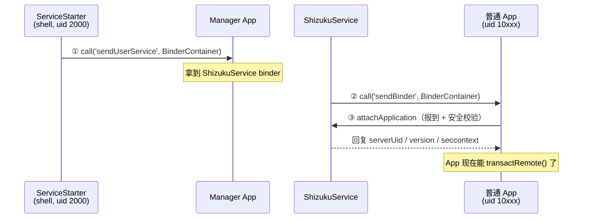

# Shizuku 源码解读：不用 Root，如何让 App 调用系统级 API？

> 系列：座舱 Android 系统服务学习笔记 01
> 关键词：Android / 系统服务 / Binder / ContentProvider / Shizuku

> 阅读前提：本文假设你了解 binder/AIDL 的基本概念（知道 `IBinder`、`BinderProxy`、AIDL 是什么）。不熟也没关系——2.2 节会边讲边补。

## 一、问题：普通 App 为什么调不了系统 API

做 Android 开发都知道，调系统能力是走 `Manager` 的。比如拿已安装应用列表：

```java
PackageManager pm = getPackageManager();
List<PackageInfo> apps = pm.getInstalledPackages(0);
```

这行代码看起来普通，但它在底层做了一次 IPC：App 进程 → `system_server` 进程里的 `PackageManagerService`。而 `PackageManagerService` 会检查调用方有没有权限。普通 App 的 uid 是 10000+，没有 `PackageManager` 的完整权限，所以很多系统级 API 它调不了，或者只能拿到残缺的数据。

那谁能调？**shell（uid 2000）**。你 `adb shell` 进去，很多东西都能碰。这也是为什么一堆「免 root 优化工具」的套路是：

```java
Runtime.getRuntime().exec("su");
// 或者 adb 模式下
Runtime.getRuntime().exec("adb shell pm enable ...");
```

这条路的问题很致命：

1. **慢**：每发一条命令都要起一个进程。
2. **不可靠**：靠解析命令行 stdout 文本，格式一变就崩。
3. **能力受限**：只能做命令行能做的事，调不了系统 API 对象。
4. **需要 root**：没有 root，App 根本调不起 `su`。

所以真正的问题是：**有没有办法让普通 App 直接用系统 API，但全程不需要 root？**

Shizuku 的答案是：**把 shell 的权限「借」给 App**——用一个独立的特权进程持有 binder，再把这个 binder 投递给 App。

---

## 二、机制：一条 binder 被投递两次

### 2.1 整体架构



关键角色只有三个：**starter（拿到 shell 权限）、server（持有特权 binder）、provider（投递 binder 的通道）**。

### 2.2 第一次投递：ServiceStarter → Manager

`ServiceStarter` 是所有事情的起点。它由 `start.sh` 里的 `app_process` 拉起，跑在 **shell（uid 2000）** 身份下。它的 `main()` 只做两件事：

```java
public static void main(String[] args) {
    // ① 创建 ShizukuService 的 binder
    Pair<IBinder, String> result = UserService.create(args);

    // ② 通过 ContentProvider 把 binder 传给 Manager App
    if (!sendBinder(service, token)) {
        System.exit(1);
    }
    Looper.loop();
}
```

`sendBinder()` 才是重点。它做了四步：

```java
// 1. 找到 Manager App 注册的 ContentProvider
provider = ActivityManagerApis.getContentProviderExternal(
        "moe.shizuku.privileged.api.shizuku", userId, null, name);

// 2. 把 binder 包进 Bundle
Bundle extra = new Bundle();
extra.putParcelable(EXTRA_BINDER, new BinderContainer(binder));

// 3. 调 call()，完成跨进程投递
Bundle reply = IContentProviderCompat.call(
        provider, null, null, name, "sendUserService", null, extra);

// 4. 断开连接
ActivityManagerApis.removeContentProviderExternal(name, null);
```

第 2 步的 `putParcelable` 最终会走到 `Parcel.writeStrongBinder()`——**这就是 binder 跨进程传递的内核机制**：内核 binder 驱动在接收端创建一个新的 `BinderProxy` 对象，指向同一个 binder 实体。

### 2.3 第二次投递：ShizukuService → 所有授权 App

Manager App 拿到 binder 后，并不是终点。真正服务普通 App 的是 `ShizukuService`，它向所有声明了 `PERMISSION` 的 App 各发一份 binder：

```java
static void sendBinderToUserApp(Binder binder, String packageName, int userId) {
    // 找到目标 App 的 ContentProvider
    provider = ActivityManagerApis.getContentProviderExternal(
            packageName + ".shizuku", userId, token, name);

    // 打包（和 ServiceStarter 完全一样的套路）
    Bundle extra = new Bundle();
    extra.putParcelable("...BINDER", new BinderContainer(binder));

    // 投递
    IContentProviderUtils.callCompat(provider, null, name, "sendBinder", null, extra);
}
```

注意到吗？**它和 ServiceStarter 的 `sendBinder()` 是同一个模式**，只是：
- 发送方从 `ServiceStarter` 变成 `ShizukuService`
- 目标从 Manager App 变成所有授权 App
- method 从 `"sendUserService"` 变成 `"sendBinder"`

这就是本文想说的第一件事：**Shizuku 的核心不是「某个奇技淫巧」，而是把「binder 通过 ContentProvider.call 投递」这个模式用了两次。**

### 2.4 为什么是 ContentProvider.call，不是 bindService？

这是很多人第一次看 Shizuku 的疑问。原因有三：

1. **bindService 需要 App 主动绑**，时机不可控；`call()` 是单向推送，server 随时可以往 App 里塞东西。
2. **call() 传的是 Bundle**，可以携带任意 `Parcelable`，包括 `IBinder`。
3. **call() 走的是 ContentProvider 的 IPC 通道**，不需要在 App 的 manifest 里声明一个 Service 给别人 bind。

一句话：**ContentProvider 不只是数据库，它的 `call()` 是一个可以传 binder 的通用 RPC 入口。**

### 2.5 权限协议：别让任意 App 都能借

如果只是「把 binder 发给所有 App」，那这个方案就是个权力后门。Shizuku 用一套权限协议兜底：

- App 必须在 manifest 里声明 `moe.shizuku.manager.permission.API_V23`，才有资格接收 binder。
- `BinderSender` 在投递前会逐个检查：
  ```java
  if (ArraysKt.contains(pi.requestedPermissions, PERMISSION_MANAGER)) {
      ShizukuService.sendBinderToManger(...);   // 是 Manager 本身
  } else if (ArraysKt.contains(pi.requestedPermissions, PERMISSION)) {
      ShizukuService.sendBinderToUserApp(...);  // 是普通授权 App
  }
  ```
- App 拿到 binder 后，还要调 `attachApplication()` 报到，server 会做一次**安全校验**：
  ```java
  // 你报的包名必须属于你的调用 uid，防冒名
  if (!packages.contains(requestPackageName)) {
      throw new SecurityException("Request package ... does not belong to uid ...");
  }
  ```

所以完整链路是：**声明权限 → 投递 binder → 报到校验 → 才能用**。

### 2.6 进阶：UserService —— 在 App 进程里跑特权代码

还有一个容易混的概念：`UserService`。它和上面说的「App 借用 server 通道」不是同一回事。

- 普通用法：App 在主进程里拿 binder，调 `transactRemote()` 转发系统 API（一次调用）。
- UserService：Shizuku 用 `app_process` 在 **App 自己的进程里** fork 一个子进程，跑 App 定义的 `UserService` 类，这个子进程拿到 server 的 binder，可以长期存活、注册系统回调。

注意：**UserService 是在 App 进程里 fork 的，而 CarService 是独立预装的中心化进程**——这是两个完全不同的进程模型，后面座舱篇会专门讲。

---

## 三、验证：自己改一行代码，看它跑起来

看源码是「读」，真正的内化是「改」。为了证明 Shizuku 的 server 真的跑在我改的代码上，我给它加了一条带标记的日志。

### 3.1 改了什么

在 `ServiceStarter.main()` 入口和 `ShizukuService` 构造方法各加一行：

```java
// ServiceStarter.java
Log.i(TAG, "W1D5-MODIFIED-MARKER: ServiceStarter.main() entered");

// ShizukuService.java
LOGGER.i("W1D5-MODIFIED-MARKER: server constructor reached");
```

### 3.2 构建（这里踩了 3 个坑）

Shizuku 的构建不是 `./gradlew assembleDebug` 就完事的，实测踩了三个坑：

| 坑 | 现象 | 解法 |
|---|---|---|
| NDK 版本 | `LicenceNotAcceptedException: ndk;29.0.13113456` | `sdkmanager --licenses` + 装 NDK 29 |
| Java 版本 | `无效的源发行版：21` | 装 JDK 21（根 `build.gradle` 设了 `sourceCompatibility = VERSION_21`） |
| brew 装 JDK 21 | ghcr.io 下载 `HTTP/2 PROTOCOL_ERROR`，卡在固定字节 | 别用 brew，直接从清华 Adoptium 镜像下 Temurin |
| start.sh 未生成 | `/sdcard/Android/data/moe.shizuku.privileged.api/start.sh` 不存在 | 绕过 app UI，直接 `app_process` 手动拉 server |

最后一个坑值得单独说：`brew install openjdk@21` 在国内会因为 ghcr.io 不稳而卡死，`HOMEBREW_BOTTLE_DOMAIN` 对它也不生效。**直接从镜像下 Temurin JDK（单文件、190MB、59MB/s）才是正解。**

### 3.3 logcat 证据

```bash
adb logcat -c
adb shell "CLASSPATH='$APK' nohup app_process /system/bin \
  --nice-name=shizuku_server moe.shizuku.starter.ServiceStarter \
  --token=w1d5test --package=moe.shizuku.privileged.api \
  --class=rikka.shizuku.server.ShizukuService --uid=2000 >/data/local/tmp/shizuku.log 2>&1 &"
adb logcat -d | grep W1D5-MODIFIED-MARKER
```

真实输出：

```text
21:20:48.821 I ShizukuServiceStarter: W1D5-MODIFIED-MARKER: ServiceStarter.main() entered
21:20:48.980 I Service : W1D5-MODIFIED-MARKER: server constructor reached
```

两条都在——**证明我改的代码真的被编译进 APK、真的在设备上跑起来了。**

补充一个「不运行也能验证」的技巧：构建完先解压 APK 搜关键字。

```bash
unzip -p app-debug.apk classes2.dex | strings | grep W1D5-MODIFIED-MARKER
# ✅ 有输出 = 代码已编译进 dex
```

---

## 四、总结

### 4.1 一句话总结

Shizuku 的本质是 **binder 投递中间人**：starter 用 shell 权限创建 server binder，server 通过 `ContentProvider.call()` 把 binder 投递给每一个授权 App。App 拿着 binder 就能以 shell 的权限调系统 API，全程不需要 root。

### 4.2 对座舱 Android 的启示

这条链路和 AAOS 的 CarService 是同一个模式：

- **ShizukuService** ≈ **CarService**（独立的常驻特权服务，App 通过 binder 访问它）
- **App 拿 ShizukuService binder** ≈ **App 调 `Car.createCar()` 拿 `ICar` binder**
- **ContentProvider.call 投递** ≈ **`Car.createCar()` 建立连接**

理解了 Shizuku，再去看 `Vehicle HAL → CarService → CarPropertyManager → App` 的黄金链路，会顺畅很多——因为「binder 怎么跨进程、服务怎么暴露接口」这套底子是一样的。

### 4.3 局限

Shizuku 依赖 ADB 或 root 授权，量产车机通常锁死 adb、不允许装第三方特权工具。所以它在这个项目里的定位是**理解 AOSP 系统服务进程模型的教具**，不是车上落地方案。

---

*本文是「座舱 Android 系统服务学习」系列第一篇。代码与实验记录开源在 [github.com/huangankun/android-car-study](https://github.com/huangankun/android-car-study)。*