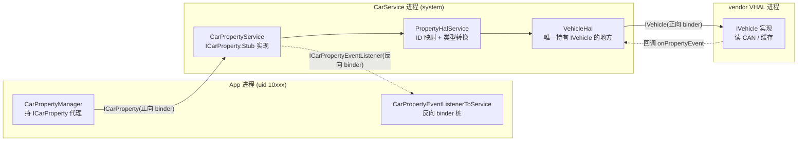
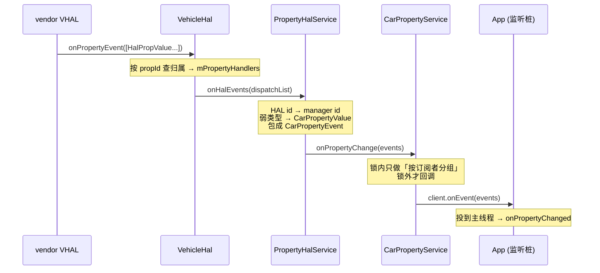

# 一个车控属性从 HAL 到 App 的旅程

> 系列：座舱 Android 系统服务学习笔记 02
> 关键词：Android / AAOS / Vehicle HAL / CarService / Binder / CarPropertyManager

> 阅读前提：知道 binder 是跨进程调用的通道、知道 HAL 在 Android 里指「厂商实现的那一层」就够了。文中所有 `dumpsys` / `logcat` 输出都是 Android 13 automotive（AAOS）模拟器实测，不是抄文档。

## 一、问题：一行 `getProperty`，背后有几个进程

在车机上读车速，代码长这样：

```java
Car car = Car.createCar(context);
CarPropertyManager mgr = (CarPropertyManager) car.getCarPropertyManager(Car.PROPERTY_SERVICE);
CarPropertyValue<Float> v = mgr.getProperty(Float.class, VehiclePropertyIds.PERF_VEHICLE_SPEED, 0);
float speed = v.getValue();   // 单位 m/s
```

看起来跟 `SensorManager.getDefaultSensor()` 没什么区别。但这一行调用要**翻过两道 binder、跨三个进程、穿过四层调用**，真正跨到厂商进程的只有一次读或一次写。

先把空间关系摆清楚：



两个关键事实：

1. **CarService 是独立预装的常驻进程**，不是 App 里的库。它和 `system_server` 一样是系统级服务，以 `system` uid 跑。
2. **只有 `VehicleHal` 这一个类真的持有 `IVehicle` binder**。整条链路上真正跨到厂商进程的，是它内部 `HalClient` 的两次调用——一个读一次写。

所以「车控属性为什么这么绕」的答案不是设计洁癖，而是职责确实分得开：App 只该看见强类型 API；权限和策略属于系统；CAN 报文属于厂商。

那这四层各自解决了什么问题？下面按三条路径拆。

---

## 二、机制

### 2.1 读：四层里每层各干一件事

#### 第一层 · App 侧：跨进程 + 异常翻译

```java
// car-lib/src/android/car/hardware/property/CarPropertyManager.java
public <E> CarPropertyValue<E> getProperty(Class<E> clazz, int propId, int areaId) {
    checkSupportedProperty(propId);                       // 本地先查属性支持
    try {
        CarPropertyValue<E> propVal = mService.getProperty(propId, areaId);
        // ★ ICarProperty code 3 —— 这里过 binder 到 CarService
        if (propVal.getValue().getClass() != clazz) {
            throw new IllegalArgumentException("Invalid property type...");
        }
        return propVal;
    } catch (ServiceSpecificException e) {
        return handleCarServiceSpecificException(e, propId, areaId, null);
    }
}
```

`CarPropertyManager` 的定位是**门面**：它把 binder 代理、异常、类型检查都藏起来，对外只留 Java API。

#### 第二层 · `CarPropertyService`：先查配置，再查权限，最后才碰 HAL

```java
// packages/services/Car/service/src/com/android/car/CarPropertyService.java
public CarPropertyValue getProperty(int prop, int zone) {
    synchronized (mLock) {
        if (mConfigs.get(prop) == null) {
            return null;   // ← 属性根本不存在，直接返回，连 HAL 都不碰
        }
    }
    String permission = mHal.getReadPermission(prop);      // 这个属性的读权限名
    if (permission == null) {
        throw new SecurityException("Platform does not have permission to read value ...");
    }
    CarServiceUtils.assertPermission(mContext, permission); // ★ 真正断言的是「调用方」的权限
    return mHal.getProperty(prop, zone);
}
```

注意 `assertPermission` 检查的是**调用方（App）**，不是 CarService 自己。CarService 跑在 `system` uid 下，读什么都能读，正因为如此，权限判断必须显式做在它这里——这是 Android 权限模型的标准做法：**能力大的那一层负责守门**。

#### 第三层 · `PropertyHalService`：ID 映射 + 弱类型转强类型

```java
// packages/services/Car/service/src/com/android/car/hal/PropertyHalService.java
private static final Map<Integer, Integer> PROPERTY_ID_HAL_TO_MANAGER = Map.of(
        VehicleProperty.VEHICLE_SPEED_DISPLAY_UNITS,
        VehiclePropertyIds.VEHICLE_SPEED_DISPLAY_UNITS);

private static int managerToHalPropId(int mgrPropId) {
    return PROPERTY_ID_MANAGER_TO_HAL.getOrDefault(mgrPropId, mgrPropId);
}

public CarPropertyValue getProperty(int mgrPropId, int areaId) {
    int halPropId = managerToHalPropId(mgrPropId);
    if (!isPropertySupportedInVehicle(halPropId)) {
        throw new IllegalArgumentException("Invalid property Id : 0x" + ...);
    }
    HalPropValue value = mVehicleHal.get(halPropId, areaId);
    if (value == null) return null;
    HalPropConfig propConfig = mHalPropIdToPropConfig.get(halPropId);
    return value.toCarPropertyValue(mgrPropId, propConfig);   // 弱类型 → 强类型（带单位/范围）
}
```

这里的映射表 `PROPERTY_ID_HAL_TO_MANAGER` 只有**一个条目**——`VEHICLE_SPEED_DISPLAY_UNITS`。其余 397 个属性，HAL 侧和 manager 侧的 propId 完全相同。

第一次看到会以为这是没写完，其实是：**映射表是特例表，查不到就用原值**（`getOrDefault(id, id)`）。用一个 `Map.of` 单条目来承担「同一概念在两套枚举里 id 不同」的历史包袱，比维护一张 398 行的全量表更难出错——全量表会过期，特例表不会。

#### 第四层 · `VehicleHal`：唯一跨进程点

```java
// packages/services/Car/service/src/com/android/car/hal/VehicleHal.java
public <T> T get(Class clazz, HalPropValue requestedPropValue) {
    HalPropValue propValue = mHalClient.getValue(requestedPropValue);   // ★ 过 binder 到 IVehicle
    if (clazz == Float.class || clazz == float.class) {
        return (T) propValue.getFloatValue(0);
    } else if (clazz == Integer.class || clazz == int.class) {
        return (T) propValue.getInt32Value(0);
    } ...
}
```

`mHalClient.getValue()` 是关键的一行，也是整个读路径上**唯一**的 binder 跳转。

但它有个反常之处：`IVehicle` 的 `getValues()` 是**异步**的 AIDL（回调式，没有返回值），而 `HalClient.getValue()` 对外是同步返回的。中间发生了什么？`HalClient` 内部用 latch / 条件变量，把「发 `getValues` + 等 `onGetValues` 回调」包成了一次同步调用。

**为什么非要异步？** 因为 VHAL 下面挂着 CAN 总线。CAN 报文有往返延迟、可能丢帧、总线忙时排队，最坏情况是几十毫秒到上百毫秒。如果 `IVehicle.getValues()` 做成同步，每次读属性就会**占住一个 binder 线程**等总线——binder 线程池是有限的（默认 16 个），十几个 App 同时轮询就足以把 CarService 拖死。

所以设计是：**底层异步（不占线程），上层用 latch 局部同步（调用方仍然拿到返回值）**。异步的责任被压在 `HalClient` 一个类里，上面四层一行都不用改。

### 2.2 写：比读多两道坎

写路径整体和读一样，但多了两道检查：

```java
public void setProperty(CarPropertyValue prop, ICarPropertyEventListener listener) {
    int propId = prop.getPropertyId();
    checkPropertyAccessibility(propId);          // ★ 坎 1：属性存在 + 有写权限字符串
    if (mHal.isDisplayUnitsProperty(propId)) {
        CarServiceUtils.assertPermission(mContext, Car.PERMISSION_VENDOR_EXTENSION);
        // ★ 坎 2：改「显示单位」这类属性，额外要 VENDOR_EXTENSION 权限
    }
    mHal.setProperty(prop);
    updateSetOperationRecorderLocked(propId, prop.getAreaId(), client);
    // 记住「谁设的」，用于事后 set 失败时的异步回调
}
```

最后一行的 `updateSetOperationRecorderLocked` 是理解整件事的关键：**写不是「调用返回就等于成功」**。VHAL 收到写请求可以先答应下来，等 CAN 总线真的执行完，再回报成功或失败。所以 `setProperty` 需要传一个反向 binder（`ICarPropertyEventListener`）——它同时承担两件事：收「值变了」（路 C）和收「写失败了」（路 B）。

`VehicleHal.set()` 本身只有一行：

```java
public void set(HalPropValue propValue) {
    mHalClient.setValue(propValue);   // ★ 过 binder 到 IVehicle.setValues()
}
```

### 2.3 事件：binder 反着走

读和写是 App 发起、CarService 响应。事件流是**反过来**的：VHAL 有变化，要主动推给 App。这是整条链路里最值得讲的一段，因为它是 binder 的「双向」在真实系统里的用法。



`VehicleHal.onPropertyEvent` 本身不做任何业务判断，只做路由：

```java
@Override
public void onPropertyEvent(ArrayList<HalPropValue> propValues) {
    synchronized (mLock) {
        for (HalPropValue v : propValues) {
            int propId = v.getPropId();
            HalServiceBase service = mPropertyHandlers.get(propId);   // 谁负责这个属性
            if (service == null) { continue; }                        // 没人认领就丢
            service.getDispatchList().add(v);
            mServicesToDispatch.add(service);
        }
    }
    for (HalServiceBase s : mServicesToDispatch) {
        s.onHalEvents(s.getDispatchList());
        s.getDispatchList().clear();
    }
}
```

`mPropertyHandlers` 是 `SparseArray<HalServiceBase>`：**每个 propId 只归属一个 HAL service**。绝大多数属性归 `PropertyHalService`，电源/输入/用户/仪表等少数归专门的服务。这个归属关系在 `init()` 里一次建好：先 `getAllPropConfigs()` 把 VHAL 的属性配置全拉下来，再逐个问每个 service「这个属性归你吗」。

构造时还有个细节：`mPropertyHal` 必须排在服务列表**最后**。

```java
mAllServices = List.of(
        mPowerHal, mInputHal, mDiagnosticHal, mVmsHal,
        mUserHal, mClusterHalService, mEvsHal, mTimeHalService,
        mPropertyHal);        // ← 注释原文：mPropertyHal must be the last
```

原因是其他 HAL service 在初始化时自己要读属性（比如电源服务要知道当前状态），得等属性层先就绪。**一个 List 的排序承担了隐式的初始化依赖**——这种设计在 AOSP 里很常见，也很容易踩。

事件到 `CarPropertyService` 后，最后一跳是分发：

```java
public void onPropertyChange(List<CarPropertyEvent> events) {
    Map<Client, List<CarPropertyEvent>> eventsToDispatch = new ArrayMap<>();
    synchronized (mLock) {
        for (CarPropertyEvent event : events) {
            int propId = event.getCarPropertyValue().getPropertyId();
            List<Client> clients = mPropIdClientMap.get(propId);   // 谁订阅了这个属性
            if (clients == null) { continue; }
            for (Client c : clients) {
                eventsToDispatch.computeIfAbsent(c, k -> new ArrayList<>()).add(event);
            }
        }
    }
    // 锁外回调 —— 注释原文：回调里可能再调 CarPropertyService，锁内回调会死锁
    for (Client client : eventsToDispatch.keySet()) {
        try {
            client.onEvent(eventsToDispatch.get(client));
        } catch (RemoteException ex) { ... }
    }
}
```

三个设计点，面试常问：

1. **锁内只分组、锁外才回调**。App 的 `onEvent` 里如果又调 CarService（很常见，比如收到车速变化后立刻读一次档位），锁内回调立刻死锁。
2. **按 Client 分组，不广播**。每个 App 只收自己订阅的属性，`mPropIdClientMap` 是 `propId → 订阅者列表`。
3. **`client.onEvent` 是 oneway**。发出去就算完成，App 卡住不会拖累 CarService。

反向的那一端在 App 侧，就是为它准备的一个桩：

```java
private static class CarPropertyEventListenerToService extends ICarPropertyEventListener.Stub {
    private final WeakReference<CarPropertyManager> mMgr;   // 弱引用，防泄漏
    @Override
    public void onEvent(List<CarPropertyEvent> events) {
        CarPropertyManager manager = mMgr.get();
        if (manager != null) manager.handleEvent(events);
    }
}
```

所以 `registerCallback` 到底做了什么？**本质是把 App 的 `ICarPropertyEventListener.Stub`（一个反向 binder）递给 CarService，让它存着。** 以后 VHAL 有变化，`client.onEvent` 就能跨进程打回来。

这也解释了一个容易搞错的点：订阅用 `rate` 控制推送频率，但 `changeMode` 是 `ONCHANGE` 的属性，`rate` 给多高都没用——代码里直接覆盖成 `SENSOR_RATE_ONCHANGE`：

```java
if (config.getChangeMode() == VEHICLE_PROPERTY_CHANGE_MODE_ONCHANGE) {
    rate = SENSOR_RATE_ONCHANGE;
}
```

### 2.4 错误码翻译：App 永远看不到 `code 4`

链路终点有个细节：VHAL 的错误码是数字，但 App 拿到的是异常类型。

```java
private <T> T handleCarServiceSpecificException(ServiceSpecificException e, int propId, int areaId, T rv) {
    int errorCode = e.errorCode;
    switch (errorCode) {
        case VehicleHalStatusCode.STATUS_NOT_AVAILABLE:   // 3
            throw new PropertyNotAvailableException(propId, areaId);
        case VehicleHalStatusCode.STATUS_TRY_AGAIN:       // 1
            throw new PropertyNotAvailableAndRetryException(propId, areaId);
        case VehicleHalStatusCode.STATUS_ACCESS_DENIED:   // 4 ★
            throw new PropertyAccessDeniedSecurityException(propId, areaId);
        case VehicleHalStatusCode.STATUS_INTERNAL_ERROR:  // 5
            throw new CarInternalErrorException(propId, areaId);
    }
}
```

`code 4` 在这个边界变成了 `PropertyAccessDeniedSecurityException`。**跨进程的错误码必须在边界翻译成语言层面的语义**，否则每个 App 都要背一张 VHAL 数字表——而且 VHAL 的枚举一改，所有 App 一起坏。

### 2.5 三种「异步」，别焊在一起

这是我自己读的时候混过的地方，单独拎出来。同一个 `setProperty`，可能从三条完全不同的路出问题：

| | 路 A：当场拒 | 路 B：事后败 | 路 C：值变化 |
|---|---|---|---|
| 触发 | App 调 set，VHAL 当场拒 | VHAL 接受，CAN 事后报失败 | VHAL 值变了 / 被 inject 伪造 |
| App 阻塞 | **是**（同步等） | 否 | 否 |
| App 收到 | 当场抛 `PropertyAccessDeniedSecurityException` | 异步 `onErrorEvent` | 异步 `onChangeEvent` |
| 代码落点 | `VehicleHal.set()` 抛 | `VehicleHal.onPropertySetError` | `VehicleHal.onPropertyEvent` |

口诀：**当场拒是同步抛，事后败是回调报，值变化是主动推。**

最容易错的是把 A 当成「异步回调回来」。不是——`HalClient.setValue` 用 latch 把异步 `setValues` 包成了同步，VHAL 拒了当场就冒泡到你 `setProperty` 的 catch 里，**根本不走 event 通道**。而 B（`onPropertySetError`）专用「写成功了但执行失败」，这才是 `setProperty` 为什么要传反向 binder 的原因。

---

## 三、验证：让它在模拟器上真跑

静态代码读完，下一步是证明它真的按这个链路走。用的环境是 Android 13 automotive 模拟器 + `cmd car_service`。

### 3.1 先把 propId 翻成人话

`propId` 是数字，不认识就只能瞎猜。`get-carpropertyconfig` 是破译钥匙：

```bash
$ adb shell cmd car_service get-carpropertyconfig | grep -iE "SPEED|GEAR|TEMP"
Property:0x11600207, Property name:PERF_VEHICLE_SPEED, access:0x1, changeMode:0x2, fs min:1.0, fs max:10.0
Property:0x11400400, Property name:GEAR_SELECTION, access:0x1, changeMode:0x1, config:[4,1,2,8,16,32,64,128,256]
Property:0x1140050e, Property name:HVAC_TEMPERATURE_DISPLAY_UNITS, access:0x3, changeMode:0x1, config:[49,48]
```

这台模拟器上共 **398 条属性**，其中 **92 条可读写（`access:0x3`）**。三个字段决定了一个属性能不能写、能不能订阅：

- `access`：`0x1` 只读、`0x2` 只写、`0x3` 读写
- `changeMode`：`0x1` ON_CHANGE（变了才报）、`0x2` CONTINUOUS（按 rate 持续推）
- 车速是 `access:0x1, changeMode:0x2`——**只读但持续上报**，这正是一个车控属性的典型形态

### 3.2 读：跨两个进程拿到值

```bash
$ adb shell cmd car_service get-property-value 0x11600207
Property:0x11600207, status: 0, timestamp: 26000546095, zone: 0x0,
floatValues: [0.0], int32Values: [], int64Values: [], bytes: [], string:
```

`status: 0` 是成功。值在 `floatValues` 里——因为车速是 FLOAT 类型，而 `HalPropValue` 是弱类型结构，所有类型的值都塞在几个数组里，`toCarPropertyValue()` 负责按配置取对的那个。

### 3.3 写：完整闭环

选一个全局可读写属性，`HVAC_TEMPERATURE_DISPLAY_UNITS`（0x1140050e，48=华氏 / 49=摄氏）：

```bash
$ adb shell cmd car_service set-property-value 0x1140050e 0 48
Property(0x1140050e) is set to 48 successfully
$ adb shell cmd car_service get-property-value 0x1140050e
Property:0x1140050e, ..., int32Values: [48], ...
$ adb shell cmd car_service set-property-value 0x1140050e 0 49   # 恢复
```

写进去、读回来，值真的变了。**这才叫闭环**——dump 出来看看不算。

### 3.4 只读属性的 `(code 4)`：三层权限，只到第三层才被拒

同一个命令，对 `GEAR_SELECTION`（`access:0x1`）执行：

```bash
$ adb shell cmd car_service set-property-value 0x11400400 0 8
Cannot set a property: ... Failed to set value for: 0x11400400, areaId: 0x0,
error: ...VehiclePropValue{...} (code 4)
```

这里的推理是整个项目里最有价值的一段：

`GEAR_SELECTION` 在 `CarPropertyService` 层**有**写权限字符串——`checkPropertyAccessibility` 放行了（否则抛的是 `SecurityException`，不是 `code 4`）。错误信息里的类型是 `android.hardware.automotive.vehicle.VehiclePropValue`，即来自 VHAL。所以：

| 段 | 位置 | 检查什么 | 这次结果 |
|---|---|---|---|
| 1 | `CarPropertyService.checkPropertyAccessibility` | 属性存在 + 写权限字符串非空 | 放行 |
| 2 | `PropertyHalService.isPropertySupportedInVehicle` | 属性在 VHAL 支持列表内 | 放行 |
| 3 | vendor VHAL | 属性 `access` 位 | **拒绝，code 4** |

**服务层放行 ≠ VHAL 放行。** 真车也一样：档位是车产生的，App 写不进去是设计。

### 3.5 `inject-vhal-event` 到底改了什么

这条命令让很多人误以为「能改属性值」：

```bash
$ adb shell cmd car_service inject-vhal-event 0x11600207 0 22.5
# logcat: CarShellCommand: Injecting VHAL event: prop=0x11600207, zone=0, value=22.5, isError=false, delayTime=0

$ adb shell cmd car_service get-property-value 0x11600207
=== 注入前 ===  Property:0x11600207, timestamp: 26000546095, floatValues: [0.0]
=== 注入后 ===  Property:0x11600207, timestamp: 26000546095, floatValues: [0.0]
```

**时间戳一字不差。** 源码解释了为什么：

```java
// VehicleHal.java
public void injectVhalEvent(int property, int zone, String value, int delayTime) {
    HalPropValue v = createPropValueForInjecting(...);
    if (v == null) return;
    mHandler.post(() -> onPropertyEvent(Lists.newArrayList(v)));  // 只伪造一次「VHAL 上报」
}
```

它只调 `onPropertyEvent` 伪造一次事件投给订阅者，**不写 VHAL 的存储值**。所以 `get()` 读真实值当然读不到——`get()` 走的是 `IVehicle.getValues()`，压根不经过这条路径。

一句话分清：

- `inject-vhal-event` = 模拟车端**发来**信号（只对订阅者生效）
- `set-property-value` = 改车端**状态**（只对 `access:0x3` 生效）
- `get-property-value` = 读车端**当前真实值**（看不到注入）

### 3.6 logcat 证明请求真的到了 CarService

`cmd car_service` 的所有操作都从 `CarShellCommand` 进来，INFO 级有记录：

```text
11-16 12:09:22.442  I CarShellCommand: Setting vehicle property: id=0x1140050e, areaId=0, value=48
11-16 12:09:22.625  D CarPropertyService: mSyncGetSetPropertyOpCount: 1
11-16 12:09:22.625  D CarPropertyService: mSyncGetSetPropertyOpCount: 0
```

`mSyncGetSetPropertyOpCount` 从 0→1→0，说明 `CarPropertyService` 确实收到了这次 set 并处理完。

这个计数器有个容易读错的地方：它是**并发同步 get/set 的限流计数器**，`runSyncOperationCheckLimit` 同时包住 `getProperty` 和 `setProperty`，两者都会 +1/-1；并发数超 `SYNC_GET_SET_PROPERTY_OP_LIMIT` 时抛 `SYNC_OP_LIMIT_TRY_AGAIN`。我最初以为「只有 set 才计数」，真机复验后推翻了——读也计数。

### 3.7 这一周踩的坑（压缩版）

| 坑 | 现象 | 根因 | 解法 |
|---|---|---|---|
| 注入不生效 | `inject-vhal-event` 有 logcat，`get` 读回旧值 | 只伪造 `onPropertyEvent`，不写存储值 | 要验证注入必须写订阅者（`registerCallback`）；改状态用 `set-property-value` |
| 只读属性写不进 | `set-property-value` 报 `(code 4)` | VHAL 按 `access:0x1` 拒，服务层已经放行 | 换 `access:0x3` 的属性；`code 4` 是第三层拒的 |
| 裸 `service call` 花屏 | 返回 `Parcel(...)` 读不出值 | 事务码不是从 1 开始（`ICar.getCarService=11`），返回是原始 Parcel | 优先用 `cmd car_service`，同样的 binder 调用，人家帮解析 |
| HAL 层没日志 | `setprop log.tag.VehicleHal VERBOSE` 无效 | `VehicleHal`/`PropertyHalService` 的日志由编译期 `DBG` 常量控制 | 要完整 trace 只能断点或改源码加 `Slogf.i` 重编 |
| 计数器误读 | 以为只有 set 会 +1 | `runSyncOperationCheckLimit` 同时包 get/set | 它是并发限流，不是「set 专用」 |

---

## 四、总结

### 4.1 一句话

**一个车控属性要过三个进程：App（`ICarProperty` 正向 binder）→ CarService（权限+策略）→ VHAL（`IVehicle` binder，CAN 总线）；事件沿反向 binder 回来。**

### 4.2 四层各自存在的理由

| 层 | 只解决一件事 | 如果不分层会怎样 |
|---|---|---|
| `CarPropertyManager` | 门面：类型、异常、跨进程细节 | 每个 App 自己写 binder 代码、自己背错误码 |
| `CarPropertyService` | 权限 + 订阅分发 | 权限判断散落各处，厂商改一个策略要动 App |
| `PropertyHalService` | ID 映射 + 弱类型↔强类型 | HAL 的数据结构和 Java 类型焊死，换厂商就崩 |
| `VehicleHal` | 唯一跨进程点 + 异步封装 | 异步细节外泄，上层每层都要处理回调 |

### 4.3 面试口径（30 秒版）

> App 读一个车控属性跨三个进程：App → CarService 走 `ICarProperty`，CarService → VHAL 走 `IVehicle`，两个都是 binder。真正跨到厂商进程的只有 `VehicleHal` 里 `HalClient.getValue/setValue` 那一处。
>
> VHAL 的 `IVehicle` 是异步 AIDL，因为底下是 CAN 总线，同步会占住 binder 线程；`HalClient` 用 latch 把它包成同步，异步细节压在那一层。
>
> 权限分三段：服务层的权限字符串、HAL 层的支持列表、VHAL 的 access 位。所以会出现「服务层放行、被 VHAL 拒」——这时 App 拿到的是 `code 4`，翻译成 `PropertyAccessDeniedSecurityException`。
>
> 事件是反向 binder：`registerCallback` 本质是把 App 的 `ICarPropertyEventListener.Stub` 递给 CarService 存着，VHAL 有变化时 `client.onEvent` 打回来。分发时锁内只分组、锁外才回调，否则 App 回调里再调服务就死锁。

---

*本文是「座舱 Android 系统服务学习」系列第二篇。代码逐行注释、dumpsys 存档与 logcat 原始日志开源在 [github.com/huangankun/android-car-study](https://github.com/huangankun/android-car-study)。*